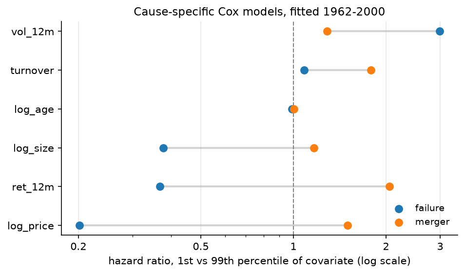
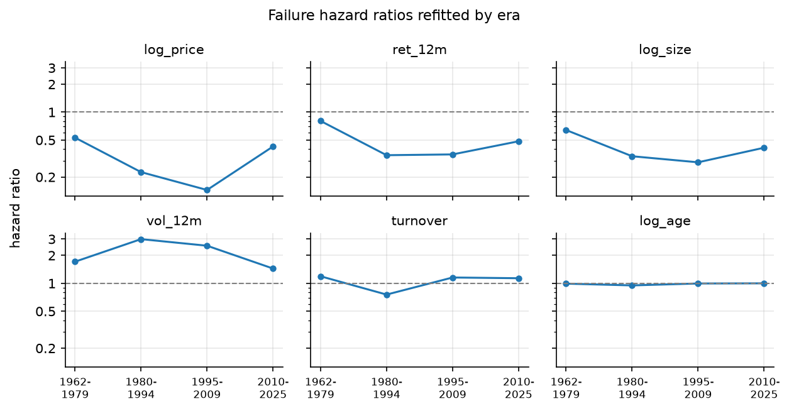
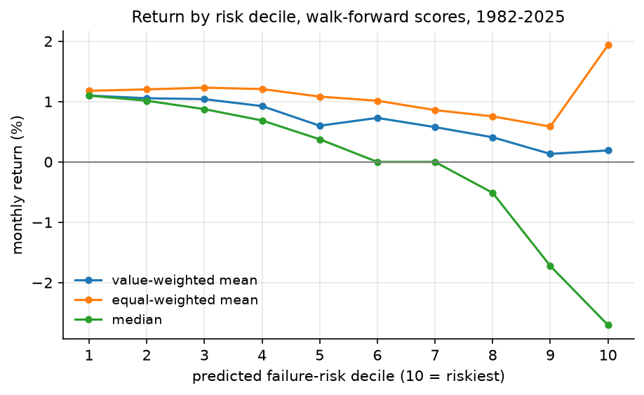
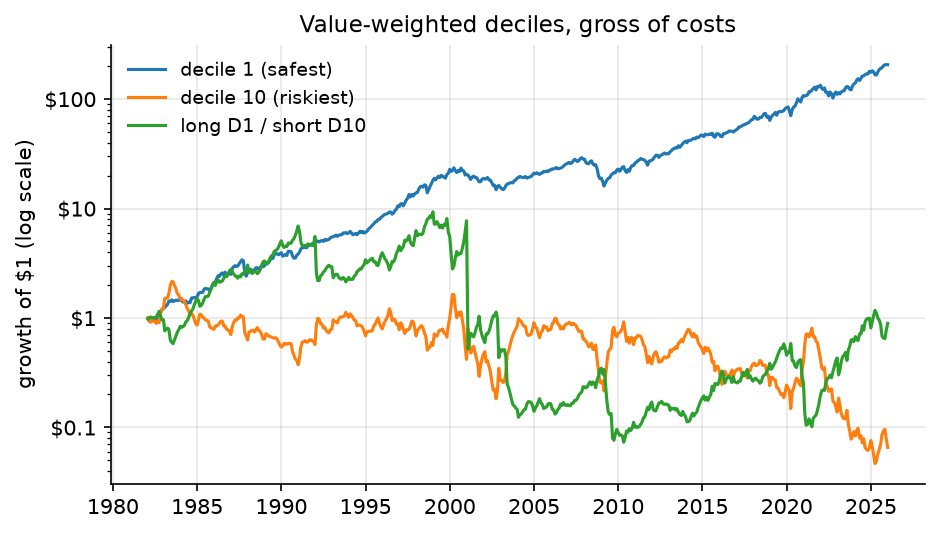

# Delisting hazard

[](https://github.com/petersifter/delisting-hazard/actions/workflows/ci.yml)

A competing-risks Cox model of US stock delisting, estimated on CRSP monthly data from 1962 to
2025 and merged point-in-time with Compustat, plus a test of whether the resulting failure-risk
score is any use as a trading signal.

Main results:

1. Failure is predictable out of sample (concordance 0.801). Failure and merger load on three of
   the six covariates with opposite signs, so a model that pools them is misspecified.
2. Accounting ratios add nothing over price and volatility once you compare models on the same
   firms. The apparent gain from adding them comes from the change in sample.
3. Acquisitions are predicted by industry merger waves, not by the firm's own characteristics.
   That is the only addition in the project that improves out-of-sample discrimination.
4. The return spread between low- and high-risk firms is exposure to size, profitability and
   momentum, not alpha: factor alpha t = 0.07, deflated Sharpe 0.58, and a Sharpe of 0.16 in the
   tradeable universe.

## Motivation

Bankruptcy prediction is usually set up as a classifier: did the firm fail or not. On CRSP that
has two problems. Most firms haven't failed *yet*, and firms also leave the exchange by being
acquired, which is close to the opposite outcome. A cause-specific hazard model handles both.

The second question comes from Campbell, Hilscher and Szilagyi (2008), who found that distressed
stocks underperform, the reverse of what compensation for risk would predict. I rebuild a
distress score from scratch and test whether it predicts returns.

## Data

### Sources

CRSP through WRDS, Annual Update vintage (the Monthly Update's recent months still get revised).

| table | CIZ name | contents |
|---|---|---|
| Monthly Stock File | `crsp.msf_v2` | returns, prices, market cap, volume, shares |
| Security info history | `crsp.stksecurityinfohist` | point-in-time security type flags |
| Delisting Information | `crsp.stkdelists` | delisting date, action type, reason, return |

Compustat, also through WRDS:

| table | contents | rows |
|---|---|---:|
| Fundamentals Quarterly | balance sheet and income items, report date `rdq` | 1,875,885 |
| Fundamentals Annual | the same annually, used for book equity | 515,532 |
| CRSP-Compustat link | `gvkey` to `permno` with valid dates | 110,092 |

Compustat is filtered to consolidation `C`, format `INDL`/`STD`, USD. Active and inactive
companies are both kept, since the inactive ones are the firms that failed or were acquired (64%
of the annual file).

The queries are in [`wrds_extract.py`](src/delisting/wrds_extract.py).

### Universe

Ordinary US common stock, filtered in the query:

```sql
WHERE sharetype = 'NS' AND securitytype = 'EQTY'
  AND securitysubtype = 'COM' AND usincflg = 'Y'
```

plus `issuertype` in {ACOR, CORP} and `primaryexch` in {N, A, Q} (NYSE, NYSE American, Nasdaq),
applied in [`load.py`](src/delisting/load.py). Trading-status flags are not used as filters,
because they drop halted and delisting securities.

### Sample

| step | security-months | securities | note |
|---|---:|---:|---|
| CRSP download, 1962-01 to 2025-12 | 3,636,832 | | |
| issuer type and exchange filters | 3,504,362 | | -132,470 |
| remove distribution duplicates | **3,486,337** | **26,387** | -18,025 duplicate rows |
| require 6 months of trailing history | **3,049,855** | **24,310** | -436,482 (see Limitations) |

The final panel has 8,533 failures. The sample ends 2025-12-31; the delisting file's last event
is 2025-12-30.

### Outcomes

The delisting file has 29,321 events across the whole CRSP universe. CRSP gives the reason as a
three-letter `delactiontype`:

| code | meaning | treatment | count in panel |
|---|---|---|---:|
| `GDR` | dropped, failed listing standards | **event** | |
| `GLI` | liquidation | **event** | |
| | *failures combined* | | **9,622** |
| `MER` | merger or acquisition | competing risk, censored | 12,400 |
| `GEX` | moved exchange | not an exit, censored | 633 |
| `LOS` | CRSP lost the feed | censored | 3 |
| | no delisting record | still trading, censored | 3,729 |
| | **total** | | **26,387** |

There are more mergers than failures. A pooled "firm disappeared" model would mostly be fitting
acquisitions, often at a premium, with the same covariates as firms dropped for trading under a
dollar.

### Point-in-time Compustat

Compustat's `datadate` is the fiscal period end. Filings come out later: median 37 days, 75th
percentile 46, 95th percentile 90. Merging on `datadate` would give the model numbers weeks before
they were public, so each quarter is dated by

| condition | publication date |
|---|---|
| `rdq` present and 0 to 365 days after `datadate` | `rdq` |
| otherwise | `datadate` + 90 days |

`rdq` exists for only 64.7% of rows and for none before 1970. The fallback can only make data
available later than it really was, never earlier.

Each firm-month gets the most recently published quarter through a backward as-of merge, ignoring
reports more than 730 days old. The `gvkey`-`permno` join uses the CCM link table restricted to
link types `LC`/`LU` and primary markers `P`/`C`, which keeps 32,296 of 110,092 rows (most of the
rest are `NR`/`NU`, meaning no link). Matching on ticker would be wrong, since tickers get reused.

Fundamentals attach to 76.4% of security-months.

### Accounting covariates

From Campbell, Hilscher and Szilagyi (2008), scaled by the market value of total assets,
MTA = market equity + total liabilities:

| covariate | definition |
|---|---|
| `nimta` | net income / MTA |
| `tlmta` | total liabilities / MTA |
| `cashmta` | cash and short-term investments / MTA |
| `mb` | market equity / book equity |

The market-value denominator moves with the share price, so leverage rises as a firm's price
falls, before any new filing. CRSP market cap is in thousands and Compustat in millions; the
conversion is in [`fundamentals.py`](src/delisting/fundamentals.py).

## Method

### Why a hazard model

3,729 securities (14.1%) have no delisting record because they were still trading at the end. A
firm listed in 2023 and one listed in 1970 have both survived, but the second tells you much more.
A classifier labels both "did not fail". A survival model treats them as right-censored and
models the hazard, the probability of failing in month $t+1$ given survival to $t$, so each firm
contributes all the months it is known to have survived.

### Covariates

Kept to six:

| covariate | definition |
|---|---|
| `log_size` | log market cap |
| `log_price` | log share price |
| `vol_12m` | trailing 12-month standard deviation of monthly returns |
| `ret_12m` | trailing 12-month compounded return |
| `turnover` | monthly volume / shares outstanding, capped at 10 |
| `log_age` | log months since entering the sample |

Rolling windows are 12 months with a 6-month minimum, and then every covariate is lagged one
month, so the row for month $t$ describes the firm at $t-1$. Without the lag, the row for the
month a firm failed would describe the firm while it was failing.

### Panel

One row per firm-month in counting-process form, `(permno, start, stop, event, covariates)`, with
time measured in months since the firm entered the sample. `event = 1` only on the last month of
a firm that exited for the cause being modeled.

### Estimation

Two cause-specific models, failure and merger, each treating the other as censored, fitted with
`lifelines.CoxTimeVaryingFitter` and a ridge penalty of 0.01.

Each covariate is clipped to its training-sample 1st and 99th percentiles and rescaled to [0, 1]:

```math
x' = \frac{\min(\max(x, p_{1}), p_{99}) - p_{1}}{p_{99} - p_{1}}
```

so a hazard ratio compares a firm at the 99th percentile of that covariate with one at the 1st,
holding the others fixed. The percentiles come from the training years only.

### Train and test

Split by date: train 1962-2000, test 2001-2025.

| split | rows | failures |
|---|---:|---:|
| train | 1,823,405 | 5,248 |
| test | 1,226,450 | 3,285 |

A random split would put month 47 of a firm in train and month 48 in test, which are almost the
same row.

## Results

### Hazard ratios



| covariate | failure HR | merger HR | failure HR per sd | p (failure) |
|---|---:|---:|---:|---:|
| `log_price` | 0.201 | 1.497 | 0.720 | <0.001 |
| `ret_12m` | 0.368 | 2.054 | 0.849 | <0.001 |
| `log_size` | 0.378 | 1.165 | 0.810 | <0.001 |
| `vol_12m` | 2.992 | 1.288 | 1.216 | <0.001 |
| `turnover` | 1.084 | 1.783 | 1.013 | 0.043 |
| `log_age` | 0.990 | 1.005 | 0.998 | 0.73 |

The first two columns are 1st-to-99th-percentile ratios. Going from a 1st-percentile price to a
99th-percentile price multiplies the monthly failure hazard by 0.201 and the merger hazard by
1.497. That range is 4 to 6 standard deviations wide for every covariate, so the
per-standard-deviation effects in the third column are much smaller: one sd of price lowers the
failure hazard by about 28%.

Price, size and past return lower the failure hazard and raise the merger hazard. A pooled model
would net these against each other, which is the case for competing risks.

### Discrimination

Concordance on the 2001-2025 test period: for a random pair where one firm failed first, the
probability the model gave that firm the higher risk. 0.5 is random ordering.

| model | concordance |
|---|---:|
| failure | **0.801** |
| merger | 0.554 |

Failure shows up in a firm's own price and size history. An acquirer's decision mostly doesn't.

Out-of-sample failure rate by predicted-risk decile:

| decile | firm-months | failures | failure rate |
|---:|---:|---:|---:|
| 1 (safest) | 122,774 | 2 | 0.002% |
| 5 | 122,658 | 180 | 0.147% |
| 9 | 122,600 | 349 | 0.285% |
| 10 (riskiest) | 122,747 | 2,250 | **1.833%** |

Decile 10 holds 2,250 of the 3,285 test failures (68.5%). The ordering is clean at the top and
noisy in the middle: deciles 3, 4 and 7 are out of order.

### Ablation

| specification | concordance | change |
|---|---:|---:|
| all six | 0.8007 | |
| without `log_price` | 0.7807 | -0.020 |
| without `vol_12m` | **0.8169** | **+0.016** |

Exchanges delist stocks that stay under $1, so the obvious worry is that the model has just found
that rule. Dropping `log_price` costs 0.020 of concordance, which says it hasn't.

Dropping `vol_12m` *improves* the test score, even though it has the largest hazard ratio above 1
in sample (2.99, p < 0.0001). The section on time variation explains why.

### Accounting covariates

With the four CHS ratios added, every accounting coefficient is significant and has the expected
sign (same 1st-to-99th-percentile scale):

| covariate | HR | p |
|---|---:|---:|
| `mb` | 2.320 | <0.0001 |
| `tlmta` | 1.637 | <0.0001 |
| `cashmta` | 0.813 | <0.0001 |
| `nimta` | 0.155 | <0.0001 |

Profitability is the strongest protective variable in the model, leverage raises the hazard, and
high market-to-book raises it too (growth valuations without earnings behind them).

The naive out-of-sample comparison looks like a clear gain:

| comparison | failure concordance |
|---|---:|
| market covariates, full sample (3,049,855 rows) | 0.8007 |
| market + accounting, merged sample (2,467,370 rows) | 0.8399 |

But requiring Compustat coverage drops 19% of rows and 13% of firms, and the firms left are
larger and older, so they're easier to rank with any covariates. Refitting both on the same merged
sample:

| model | failure | merger |
|---|---:|---:|
| market covariates only | **0.8482** | 0.5597 |
| market + accounting | **0.8399** | 0.5538 |

The accounting ratios make out-of-sample discrimination slightly worse. One reading is that the
market has already put the accounting information into price and volatility by the time the
filing comes out, about 37 days after the quarter ends. It also means significance in sample and
value out of sample are different things: `nimta` has a hazard ratio of 0.155 at p < 0.0001 and
still doesn't help rank firms the model hasn't seen, the same pattern as `vol_12m`.

Two robustness checks, neither of which changes this:

**Book equity.** Fama-French book equity needs preferred stock at redemption value, then
liquidating value, then carrying value, and only the last is in the quarterly file. Falling back
to the annual file (used from six months after fiscal year end) recovers 257,765 firm-months and
lifts `mb` coverage from 76.7% to 84.1%.

**Financials.** SIC 6000-6999 is usually excluded from distress models because 90% leverage is
normal for a bank. It's 18.1% of the panel and is kept in the results above.

| failure model | all firms | ex-financials |
|---|---:|---:|
| market covariates only | 0.8482 | 0.8568 |
| market + accounting | 0.8399 | 0.8514 |
| `tlmta` hazard ratio | 1.637 | **1.886** |

Without financials the leverage coefficient rises from 1.637 to 1.886, both concordances go up a
little, and the accounting ratios still hurt.

The rest of the README uses the market-covariate model on the full sample.

### Predicting acquisitions

Firm characteristics describe the firm. An acquisition is someone else's decision, and the M&A
literature points to industry conditions instead: takeovers come in waves, and targets tend to be
cheap and small for their industry.

| covariate | definition |
|---|---|
| `ind_merger_rate` | share of same two-digit SIC firms acquired over the trailing year |
| `rel_mb` | market-to-book minus the industry-month median |
| `rel_size` | log size minus the industry-month median |

The merger rate uses only earlier months, so a firm's own acquisition can't feed its own
predictor (there's a test for this).

| merger model | concordance |
|---|---:|
| market covariates only | 0.5597 |
| + accounting | 0.5538 |
| **+ M&A covariates** | **0.5780** |

`ind_merger_rate` has a hazard ratio of 1.590 (p < 0.0001). The gain is small, and merger timing
stays far harder to predict than failure (0.578 against 0.801), but it's the only addition in the
project that helps either model out of sample.

### Calibration

Concordance only measures ranking. A model can order firms well and still get the level of risk
wrong. Predicted probability of failing within 12 months against what happened, test period:

| bin | predicted | observed | observed / predicted |
|---:|---:|---:|---:|
| 1 (safest) | 0.782% | 0.029% | 0.04 |
| 2 | 1.006% | 0.060% | 0.06 |
| 3 | 1.231% | 0.104% | 0.08 |
| 4 | 1.476% | 0.236% | 0.16 |
| 5 | 1.751% | 1.720% | 0.98 |
| 6 | 2.083% | 2.637% | 1.27 |
| 7 | 2.582% | 1.579% | 0.61 |
| 8 | 3.413% | 2.302% | 0.67 |
| 9 | 4.930% | 5.404% | 1.10 |
| 10 (riskiest) | 9.841% | 17.860% | 1.82 |
| **all** | **2.910%** | **3.193%** | **1.10** |

The overall rate is close, but the predicted range across bins is about 12x and the realized range
about 600x. The model is far too pessimistic about safe firms and too optimistic about the
riskiest. The score is fine for ranking and for the portfolio sorts below; its probabilities
shouldn't be quoted.

The baseline here is a single constant estimated from the training data,
$h_0 = \text{events} / \sum e^{\text{lp}}$ (a Breslow estimate without duration dependence), so
$P(\text{fail within } H) = 1 - \exp(-H h_0 e^{\text{lp}})$. lifelines' baseline curve isn't used
because it is built on centered covariates and stops at the longest training duration, which 9.5%
of test rows exceed. Dropping duration dependence is reasonable because `log_age` and its
interaction with time are both insignificant.

## Time variation

Cox assumes each covariate multiplies the baseline hazard by the same factor in 1965 and in 2020.
`CoxTimeVaryingFitter` has no Schoenfeld test, so I refit the model separately on four eras.



| covariate | 1962-79 | 1980-94 | 1995-2009 | 2010-25 | max/min |
|---|---:|---:|---:|---:|---:|
| `log_price` | 0.531 | 0.226 | 0.145 | 0.427 | **3.67** |
| `ret_12m` | 0.804 | 0.344 | 0.350 | 0.485 | 2.34 |
| `log_size` | 0.641 | 0.335 | 0.288 | 0.414 | 2.23 |
| `vol_12m` | 1.711 | 2.995 | 2.543 | 1.443 | 2.08 |
| `turnover` | 1.191 | 0.756 | 1.156 | 1.135 | 1.58 |
| `log_age` | 0.992 | 0.950 | 0.996 | 1.000 | 1.05 |

Five of the six move a lot. Only `log_age` is stable, and it was never significant. This is the
`vol_12m` puzzle from the ablation: its hazard ratio was near 3 for 1980-2009 and 1.44 for
2010-2025, so a model trained on 1962-2000 applied an effect that had faded by the test period.

That table measures drift across calendar eras, which is non-stationarity. The proportional
hazards assumption is a different claim, that an effect is constant over a firm's *age*. Adding
covariate x time interactions (time standardized) tests both:

| failure model | concordance | change |
|---|---:|---:|
| no interactions | **0.8007** | |
| + covariate x log(stop) | 0.7945 | -0.006 |
| + covariate x year | 0.7775 | -0.023 |

Duration interactions (a ratio away from 1 means the effect changes as the firm ages):

| term | HR | p |
|---|---:|---:|
| `ret_12m_x_t` | 1.068 | 0.005 |
| `log_price_x_t` | 1.027 | 0.012 |
| `log_size_x_t` | 1.025 | 0.087 |
| `vol_12m_x_t` | 0.958 | 0.081 |
| `turnover_x_t` | 1.010 | 0.784 |
| `log_age_x_t` | 1.001 | 0.971 |

Proportional hazards is only mildly violated: two interactions are significant, both close to 1.
The era drift is the bigger problem. Modeling either kind of time variation makes the test score
worse, because the interactions fit in-sample structure that doesn't carry over.

So the hazard ratios above are specific to 1962-2000. Since modeling the drift doesn't help, the
backtest avoids it by refitting every three years on an expanding window, so no model is used far
from the years it was fitted on.

## As a trading signal

### Walk-forward

- 20-year burn-in, so scoring starts in **1982**
- refit every **3 years** on all earlier data
- each block is scored by a model fitted only on months before it
- 15 refits, 2,539,851 scored firm-months, 1982-2025

### Returns by decile

Firms are ranked each month by predicted failure hazard and sorted into deciles.



| decile | value-weighted | equal-weighted | median |
|---:|---:|---:|---:|
| 1 (safest) | 1.099% | 1.178% | 1.098% |
| 2 | 1.055% | 1.201% | 1.013% |
| 3 | 1.039% | 1.230% | 0.874% |
| 4 | 0.924% | 1.207% | 0.686% |
| 5 | 0.599% | 1.082% | 0.374% |
| 6 | 0.729% | 1.013% | 0.000% |
| 7 | 0.576% | 0.858% | 0.000% |
| 8 | 0.408% | 0.754% | -0.513% |
| 9 | 0.132% | 0.585% | -1.724% |
| 10 (riskiest) | 0.189% | **1.935%** | **-2.703%** |

Mean monthly returns, and the median of firm-month returns. The value-weighted means and the
medians fall with predicted risk, which is the distress anomaly.

The equal-weighted mean jumps at decile 10. Decile 10 is mostly penny stocks:

| | decile 10 |
|---|---:|
| median price | $0.97 |
| median market cap | $9.6M |
| firm-months under $1 | 50.7% |
| median monthly return | -2.70% |
| 99th percentile monthly return | +141.7% |

A few huge months in sub-dollar microcaps drive the equal-weighted mean. The typical decile-10
stock has the worst return of any decile.

### Performance



Value-weighted and rebalanced monthly. Turnover is 10.5% a month for decile 1 and 11.9% for decile
10; at 50bp one way that costs the spread 0.112% a month.

| strategy | ann. return | ann. vol | Sharpe | max DD | hit rate |
|---|---:|---:|---:|---:|---:|
| decile 1 long | 12.17% | 14.19% | 0.86 | -45.5% | 65.0% |
| decile 10 long | -6.68% | 42.71% | -0.16 | -98.4% | 45.5% |
| **long D1 / short D10** | **-1.63%** | 38.09% | **-0.04** | **-99.3%** | 59.7% |

528 months, after costs. Sharpe here is compound annual return over annualized volatility.

The spread averages +0.909% a month and still loses money. The short leg has 42.7% annual
volatility and the occasional +141% month, and at that volatility the compounded return is
negative whatever the mean. On arithmetic returns the spread's Sharpe is 0.29 before costs and
0.25 after.

### Factor regression

Fama-French five factors plus momentum from Ken French's library, HAC standard errors with 6
lags, 528 months. CRSP dates each month by its last trading day and the French files by calendar
month end, so returns are re-dated to month end before the merge.

| portfolio | alpha/yr | t | Mkt-RF | SMB | HML | RMW | CMA | MOM | $R^2$ |
|---|---:|---:|---:|---:|---:|---:|---:|---:|---:|
| D1 long | -0.14% | -0.52 | 0.957 | -0.135 | -0.024 | 0.088 | 0.026 | 0.118 | 0.987 |
| D10 long | -0.47% | -0.10 | 1.080 | 1.191 | -0.326 | -1.541 | 0.551 | -0.887 | 0.668 |
| D1 - D10 | +0.33% | **0.07** | -0.123 | **-1.326** | 0.302 | **1.629** | -0.524 | **1.004** | 0.574 |

No alpha in any of them. The spread is short small stocks (SMB -1.33) and long profitable firms
(RMW +1.63) and recent winners (MOM +1.00), since high-risk firms are small, unprofitable and
falling. The factor model already prices all three.

### Deflated Sharpe

Twelve specifications were estimated in this project (two causes, three ablations, two weighting
schemes, two universes, three portfolio constructions). The deflated Sharpe ratio (Bailey and
Lopez de Prado 2014) asks whether a Sharpe beats the best of N tries by luck, adjusting for skew
and kurtosis. Sharpe ratios here are arithmetic, annualized and before costs.

| series | Sharpe | threshold | DSR | skew | kurtosis |
|---|---:|---:|---:|---:|---:|
| D1 - D10, value-weighted | 0.286 | 0.251 | **0.584** | -2.30 | 16.2 |
| D1 - D10, equal-weighted | -0.255 | 0.251 | 0.000 | -2.59 | 19.6 |
| D1 long | 0.929 | 0.251 | 1.000 | -0.60 | 5.1 |

Below 0.95 can't be told apart from luck, and the spread's 0.584 is below it; after costs its
Sharpe of 0.25 is right at the threshold. The long-only decile 1 passes, but the factor regression
shows it is a 0.96-beta market portfolio with -0.14% alpha. Its Sharpe reflects the equity
premium, not the model.

### Tradeable universe

The spread is concentrated where it can't be traded. Keeping firm-months with a prior-month price
of at least $5 and market cap of at least $100M leaves 1,344,409 of 2,539,672 observations
(52.9%):

| decile | value-weighted mean |
|---:|---:|
| 1 | 1.109% |
| 5 | 1.151% |
| 10 | 0.366% |

D1 - D10 after costs: 4.16% a year, Sharpe 0.16, max drawdown -75.7%. Returns still fall with
risk, but there's no money in it.

### Conclusion

Factor alpha (t = 0.07), the deflated Sharpe (0.584) and the tradeable backtest (Sharpe 0.16) all
agree. The hazard score predicts delisting; it doesn't predict alpha. None of this is causal, and
it doesn't show the distress anomaly is absent in general, only that this measure of it doesn't
survive factor adjustment and the multiple-testing correction.

## Limitations

- **Six months of history required.** This drops 1,089 failures and 2,077 securities. Firms that
  fail soon after listing are excluded and aren't a random subset, so nothing here applies to
  them.
- **Time variation.** Era drift is large and modeling it makes things worse. Walk-forward refits
  work around it without fixing it, and the hazard ratios are period-specific.
- **Calibration.** Good overall, poor across bins. Use the score to rank, not to quote
  probabilities, and the constant baseline is an approximation.
- **Delisting file ends 2025-12-30, returns 2025-12-31.** A delisting on the 31st would show as
  censored.
- **Costs at 50bp one way.** Optimistic for decile-10 microcaps, about right for the rest.
- **`turnover`** is marginal (p = 0.043) and capped at 10.
- **`rdq` missing for 35% of quarterly rows.** Those rows use `datadate` + 90 days, which is
  conservative but sometimes later than the real filing.
- **The Compustat merge drops 19% of rows**, mostly smaller, younger firms, so the accounting
  results apply to a different population from the headline model.
- **Financials are kept** in the headline results (18.1% of the panel). Excluding them doesn't
  change the conclusion but moves the leverage coefficient a lot.
- **US only.**

## Running it

```bash
uv sync
uv run pytest                                   # 31 tests on synthetic data, no WRDS needed
uv run python -m delisting.wrds_extract --all --username YOU
```

`wrds_extract` writes the five CSVs that `load.py` and `fundamentals.py` read into `data/raw/`.
The analysis is the functions in `src/delisting/`, run on that panel; there is no single script
that rebuilds every table. The factor data comes from Ken French's site at runtime.

CRSP and Compustat are licensed and aren't in the repo; `data/` is gitignored.

## Layout

| path | contents |
|---|---|
| [`wrds_extract.py`](src/delisting/wrds_extract.py) | WRDS queries |
| [`load.py`](src/delisting/load.py) | monthly and delisting panels, filters, outcome codes |
| [`fundamentals.py`](src/delisting/fundamentals.py) | CCM link, point-in-time Compustat merge, CHS ratios |
| [`features.py`](src/delisting/features.py) | lagged covariates, counting-process panel, time split |
| [`model.py`](src/delisting/model.py) | scaling, Cox fits, hazard ratios, concordance, time interactions |
| [`diagnostics.py`](src/delisting/diagnostics.py) | era refits, risk deciles, calibration |
| [`backtest.py`](src/delisting/backtest.py) | walk-forward scores, decile returns, turnover, performance |
| [`factors.py`](src/delisting/factors.py) | Ken French factors, factor regressions, deflated Sharpe |
| [`plots.py`](src/delisting/plots.py) | figures |

## References

- Bailey, D. and M. Lopez de Prado (2014). The deflated Sharpe ratio. *Journal of Portfolio
  Management* 40(5), 94-107.
- Campbell, J., J. Hilscher and J. Szilagyi (2008). In search of distress risk. *Journal of
  Finance* 63(6), 2899-2939.
- Cox, D. (1972). Regression models and life-tables. *Journal of the Royal Statistical Society B*
  34(2), 187-220.
- Fama, E. and K. French (2015). A five-factor asset pricing model. *Journal of Financial
  Economics* 116(1), 1-22.
- Shumway, T. (2001). Forecasting bankruptcy more accurately: a simple hazard model. *Journal of
  Business* 74(1), 101-124.
